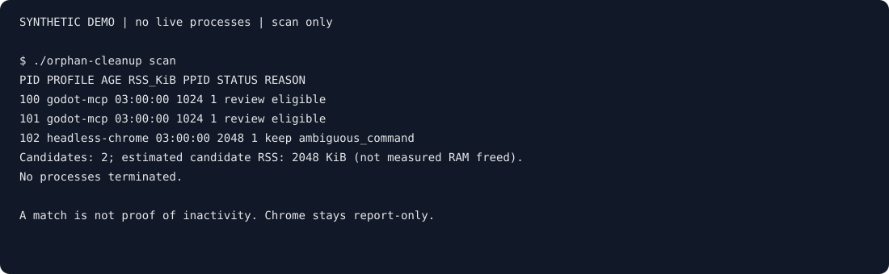

# macOS Orphan Process Cleanup

**What's still running after your developer tools close?**

A scan-first macOS CLI for investigating leftover developer processes. Built for
people working with MCP, local agents, and browser automation—not a RAM optimizer
or a universal orphan detector.

**Supported today:** narrow Godot MCP matching and headless Chrome review.
Chrome stays report-only. Other MCP servers, Unity, arbitrary Node/Python, and
containers are not supported profiles; help shape which specific profile comes next.



*Synthetic, scan-only output—not a real process capture or memory-savings claim.*
[Reproduce the demo or replay the terminal recording](docs/DEMO.md).

### Try the read-only scan; help widen coverage

Use the quick start below, then tell us whether installation worked, whether the
reasons made sense, and which specific developer process you need to investigate.
A missing match is useful feedback too. Open a bug/false-positive or profile-request
issue with your tool version, macOS version, expected behavior, and a **redacted or
synthetic example**. No cleanup or verbose output is needed. Never share tokens,
private paths, or raw process listings.

[Launch post drafts and audience framing](docs/LAUNCH.md) are ready to adapt;
no posts have been published on your behalf.

## Status and scope

**v0.2.0 is published.** The current CLI reports `0.2.0`.
The canonical `./orphan-cleanup` wrapper and existing
`./cleanup_orphan_processes.sh` entrypoint share one core CLI and the same safety
rules. Local tooling, both hosted architecture jobs, and downloaded-asset verification
pass. Optional Unity
visibility is deferred and is not supported.

See [profile rules](docs/PROFILES.md) and the [changelog](CHANGELOG.md).
The [release tracker](docs/ROADMAP.md) records acceptance gates; its milestone
status and completion evidence are maintained alongside implementation.

## Requirements and onboarding

Use macOS with stock Bash 3.2 and built-in command-line tools. No extra runtime
or sudo is needed. Never run cleanup as root. Review the checkout before running:
older revisions performed cleanup by default.

```bash
git clone --branch v0.2.0 https://github.com/humzatariq-dev/macos-orphan-process-cleanup.git
cd macos-orphan-process-cleanup
./orphan-cleanup --help
./orphan-cleanup --version

# Read-only: no signals or log files
./orphan-cleanup
./orphan-cleanup scan --profile godot-mcp --min-age-hours 6
./orphan-cleanup scan --profile headless-chrome
```

## Release archive verification

Download `orphan-cleanup-0.2.0.tar.gz` and its `.sha256` file from the v0.2.0
GitHub release into the same directory. Before extracting, run:

```bash
shasum -a 256 -c orphan-cleanup-0.2.0.tar.gz.sha256
tar -xzf orphan-cleanup-0.2.0.tar.gz
cd orphan-cleanup-0.2.0
```

The checksum detects download corruption; it is not a separate publisher signature.

## Install, upgrade, and uninstall

Review a trusted checkout before running scripts; do not pipe remote scripts into
a shell. No sudo, service, daemon, or scheduled cleanup is needed. These are the
verified installer commands:

```bash
./install.sh                         # default prefix: "$HOME/.local"
./install.sh --prefix "$HOME/.local"
export PATH="$HOME/.local/bin:$PATH"
orphan-cleanup --version
orphan-cleanup scan
```

Persist that PATH setting in your shell startup file if desired. A custom prefix
uses `PREFIX/bin`; add that directory instead. Quote prefixes containing spaces.
To upgrade, review the desired checkout, rerun the installer with the **same
prefix**, and check `orphan-cleanup --version`. Versioned archives and SHA-256 checksums are available in the repository
Releases section. Verify the checksum before extracting and installing.

```bash
./install.sh --uninstall                         # default "$HOME/.local"
./install.sh --uninstall --prefix "$HOME/.local" # or your original prefix
```

Uninstall with the checkout's installer, not broad recursive deletion commands.
Review any retained cleanup logs separately; removing the tool does not undo
signals or recover lost work. Remove your PATH entry only if no other tools use it.

## CLI

```text
./orphan-cleanup [scan] [--profile godot-mcp|headless-chrome] [--min-age-hours N] [--verbose]
./orphan-cleanup clean --profile godot-mcp|headless-chrome --pid PID [--pid PID ...] [--min-age-hours N] [--yes]
./orphan-cleanup --help
./orphan-cleanup --version
```

- No arguments means read-only scan of both built-ins. `--dry-run` and `-n`
  are scan aliases, not valid with `clean`.
- Minimum age defaults to **3 hours**; N must be an integer **1–8760** inclusive.
- `clean` requires exactly one built-in profile and explicit repeated `--pid PID`
  flags. PIDs must be integers greater than 1, without duplicates. No implicit
  “all candidates” selection exists. Chrome is report-only even with `clean`.
- Unknown arguments/profiles, missing values, duplicate options (except distinct
  `--pid` selections), and extra positional arguments are rejected.
- `--verbose` is **scan-only**. It reveals full commands, potentially including
  tokens, private paths, URLs, and other secrets; redact before sharing.

### Deliberate cleanup

First scan, investigate whether work is still needed, then select actual PIDs.
The following is syntax only: replace placeholders after review, do not copy
unexamined PIDs from examples or old output.

```text
./orphan-cleanup clean --profile godot-mcp --pid PID_A --pid PID_B --min-age-hours 6
```

Cleanup collects a fresh preview and requires exactly `yes` from a TTY. Any other
response or EOF cancels successfully without signalling. Non-TTY cleanup requires
`--yes`; this skips **only the prompt**, not preview, explicit selection,
revalidation, eligibility, or logging. It is not an automation safety guarantee.

The whole selection is validated before any signal. Any absent or ineligible
selected PID fails the request without signalling any PID. Immediately before
each SIGTERM, identity and eligibility are checked again. Changes during execution
can cause partial completion. Outcomes distinguish confirmed exits, disappearance
before signal, changed identity/eligibility, survivors, and operational errors.
Observation is bounded to about five seconds per PID; there is no SIGKILL
escalation, process-group signalling, or recursive tree termination.

### Exit codes

| Code | Meaning |
| --- | --- |
| 0 | Successful scan/help/version; cleanup with all selected PIDs confirmed exited or disappeared before signal; user cancellation. |
| 1 | Absent/ineligible selection (no signals); collection, logging, or other operational failure; changed identity/eligibility, signal failure, or survivors. |
| 2 | Invalid/unsupported arguments, unsupported platform, or root cleanup. |

### Logs and migration

Scan/help/version do not write files. Cleanup appends to
`$HOME/cleanup_orphan_processes.log`; set `LOGFILE` to override this path.
The log must be writable before signalling; logging failures stop further work.
New logs use restrictive permissions; full commands are omitted by default.
Logs still contain process IDs and outcomes: review access and redact before sharing.

Legacy bare numeric ages are rejected. Replace
`./cleanup_orphan_processes.sh 6` with
`./orphan-cleanup scan --min-age-hours 6`. The existing script accepts the same
CLI as the wrapper. Scan output is not authorization to terminate a process.

## Safety, limitations, and privacy

Only narrowly matching Godot processes can be eligible; all Chrome matches are
report-only. See [exact rules and reason codes](docs/PROFILES.md).
Age, repeated commands, and PPID 1 are clues, not proof of abandonment. Termination
can interrupt useful work or lose data. Scanning does not fix the leaking launcher.

Flattened macOS `ps` output does not preserve argument boundaries or quoting;
ambiguous matches fail closed. Portable shell revalidation reduces but cannot
eliminate the PID-reuse race between checking and signalling. It is not atomic
identity checking and cannot guarantee harmless termination.

RSS is a point-in-time estimate, not measured RAM freed. Shared pages and changing
workloads prevent exact reclamation claims. There is no telemetry. Do not paste
raw process listings into issues. [Historical sample output](docs/sample-run.txt)
is legacy, not evidence of current behavior or memory reclamation.

## Troubleshooting

- **Command not found:** use `./orphan-cleanup` from the checkout, or add the
  installation's `bin` directory to PATH. `command -v orphan-cleanup` locates
  the selected copy; compare its `--version` after upgrading.
- **No matches / kept processes:** review [profile rules](docs/PROFILES.md).
  PPID 1 and age are conservative filters, not proof of a leak. Chrome is
  report-only; Unity is deferred. Do not broaden matches just to obtain candidates.
- **Cleanup refused:** do not use sudo. Select one profile and fresh, explicit
  PIDs; stale or ineligible selections fail closed. Review logging permissions
  at `LOGFILE` (or the default path) rather than disabling logging.
- **Survivors or identity changes:** investigate and rescan. There is no automatic
  escalation; never reuse old PID selections blindly.
- **Need help:** use the issue forms with version, OS/build, architecture, and
  redacted scan output. No cleanup is needed to report a problem. Avoid sharing
  verbose output, tokens, private paths, usernames, or raw process listings.

## Development and verification

See [CONTRIBUTING.md](CONTRIBUTING.md) for checks and safety invariants and the
[reproducible synthetic demo](docs/DEMO.md) for scan-only output.
Runtime requires no additional dependencies. Development needs Python 3 and
ShellCheck 0.11.0. Run `/bin/bash scripts/check.sh` for syntax/lint, core and
CLI/PTY tests, installation lifecycle, packaging and artifact verification.
`/bin/bash scripts/package.sh` writes a committed-source archive and SHA-256
checksum under `dist/`. Packaging alone is not publication.

Local environment: macOS 27.0.1 (26A434), arm64, Bash 3.2.57. Hosted CI also
passes on `macos-15` and `macos-15-intel`; see the verification matrix below.

## License

[MIT](LICENSE).

Development test dependency: Python 3 is required for the CLI and pseudo-terminal
suite; the production tool still uses only stock Bash and macOS utilities.

## Verification matrix

| Environment | Evidence | Status |
| --- | --- | --- |
| Local macOS 27.0.1 (26A434), arm64, Bash 3.2.57 | Full checks, installer and artifact lifecycle | Passed |
| GitHub `macos-15`, Apple Silicon | CI job logs record exact OS/build and Bash | Passed |
| GitHub `macos-15-intel`, Intel | CI job logs record exact OS/build and Bash | Passed |
| Other macOS versions/architectures | No test evidence yet | Unverified |

See the repository Actions tab and [release checklist](docs/RELEASE.md).
